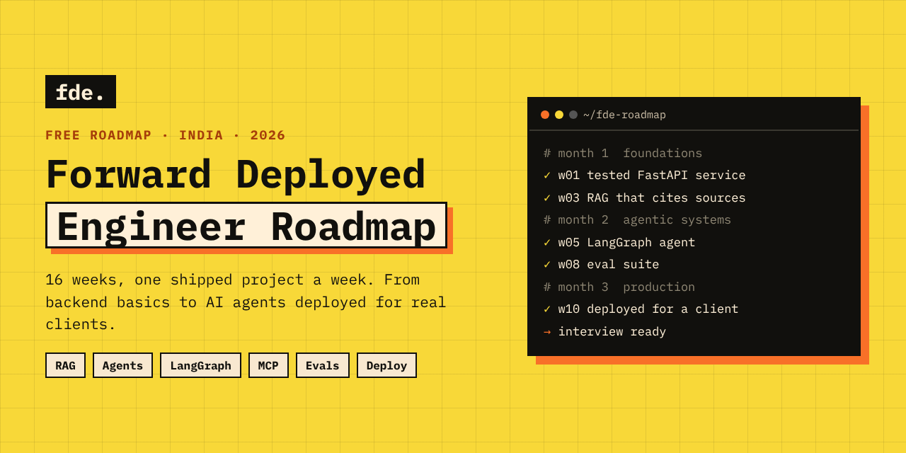
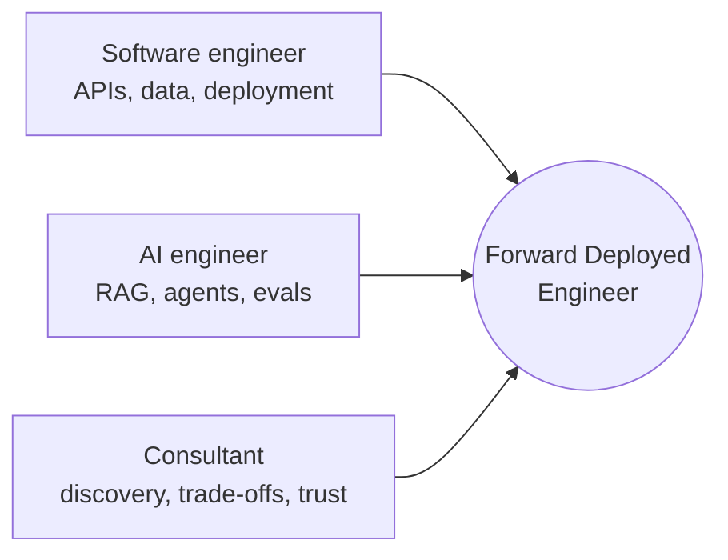
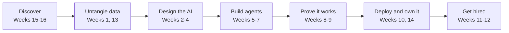

<h1 align="center">Forward Deployed Engineer Roadmap 2026</h1>

<b>A free, week-by-week path to becoming a Forward Deployed Engineer (FDE): the engineer who takes AI from a demo to a client's production systems.</b>

⭐ <b>Star this repo</b> to save it and get updates as new weeks and resources land.

---

## What's inside

| Section | What you get |
| --- | --- |
| 🗺️ **[The 16 weeks](#the-16-weeks)** | Every week with its lessons, what you ship, primary-source resources and self-check questions |
| 🧰 **[The FDE tool stack](#the-fde-tool-stack)** | What job posts ask for, and where each tool is learned |
| 🎯 **[Interview guide](interview/README.md)** | The rounds, how six companies run them, scenario questions with answers |
| 🏗️ **[AI system design](system-design/README.md)** | Six designs with diagrams: RAG, support agent, research agent, voice, gateway, extraction |
| 🚀 **[25 portfolio projects](projects/README.md)** | Client-style project ideas with starting repos |
| ✅ **[Checklists](checklists/README.md)** | Engagement kickoff, warning signs, production readiness |
| 📖 **[Glossary](glossary.md)** | 47 terms in plain English |
| ☑️ **[Skills checklist](#skills-checklist)** | Tick off what you can do |

## Who is a Forward Deployed Engineer?

An FDE sits with a client, finds the real problem, connects AI to their messy data and existing systems, and ships something that runs in production. Then they bring what they learned back to the product team.

| Role | Main job | Measured by |
| --- | --- | --- |
| Software engineer | Builds and maintains the product | Features shipped, reliability |
| ML engineer | Trains and improves models | Model metrics |
| AI engineer | Builds AI features into the product | Product quality, adoption |
| **Forward Deployed Engineer** | **Makes AI work for one client, in their systems** | **The client's business metric moving** |

## Why learn it now

- FDE job postings in India were about **19 times higher** in June 2026 than a year earlier (Indeed data, [reported by PTI](https://www.peoplematters.in/news/workforce-planning/demand-for-forward-deployed-engineers-jumps-19-fold-in-india-report-52770)).
- **52 organisations** in India were hiring FDEs in July 2026, FDE hiring grew **130%** in a year, and only about **1,200** engineers are estimated to be fully ready ([CIEL HR, Aug 2026](https://www.cielhr.com/?p=357198)).
- About **80%** of Indian FDE demand is in Bengaluru, Delhi-NCR and Hyderabad. Early-stage roles pay around **₹35–45 L** a year and experienced specialists **₹70–90 L** ([CIEL HR](https://www.cielhr.com/?p=357198)).
- **45%** of current FDEs came from software engineering, 22% from solutions engineering and 15% from data roles ([Bloomberry, 1,000 job posts](https://bloomberry.com/blog/i-analyzed-1000-forward-deployed-engineer-jobs-what-i-learned/)).

*These are market figures, not a promise of a job or salary.*

## The FDE engagement, and where you learn each part

## How to use this roadmap

1. **Go in order.** Month 1 is the engineering floor everything else stands on. Don't skip it because agents look more exciting.
2. **Ship the weekly deliverable.** Each week ends with one thing on your GitHub. That is your portfolio.
3. **Use the primary sources.** Every resource is an official doc, paper or engineering blog, chosen for the lesson that uses it.
4. **Check yourself.** Answer the questions at the end of each week out loud before moving on.
5. **Plan 10–15 hours a week.** 12 core weeks take about 90 days alongside a full-time job. Weeks 13–16 are optional.

## The 16 weeks

| Week | Topic | You ship |
| --- | --- | --- |
| [1](weeks/week-01.md) | Python and the engineering floor | A small FastAPI CRUD service (a notes or task API works fine) backed by a real database, tested, pushed to GitHub with a README that explains how to run it |
| [2](weeks/week-02.md) | How LLMs actually work | A command-line tool, no framework, that takes a plain-English instruction and calls the correct one of three Python functions you wrote via tool calling |
| [3](weeks/week-03.md) | Retrieval, from first principles | A document Q&A tool over a real PDF corpus (your own notes, or a company’s public docs) that answers questions and cites the exact source chunk it used |
| [4](weeks/week-04.md) | The agent loop, by hand | A from-scratch agent loop, still zero frameworks, using three or more tools, that retries failed calls and stops cleanly when done or after a step limit |
| [5](weeks/week-05.md) | LangGraph, properly | A LangGraph agent with at least one conditional branch and one human-approval checkpoint gating a risky action, like sending an email or making a purchase |
| [6](weeks/week-06.md) | MCP and the tool ecosystem | Your own MCP server, wrapping a public API you actually like (GitHub issues or a CSV file works fine), that any MCP-compatible client can plug into |
| [7](weeks/week-07.md) | Multi-agent systems and memory | A two-to-three-agent system with a supervisor routing to specialists |
| [8](weeks/week-08.md) | Evaluation, the actual differentiator | An eval suite for your multi-agent system with a pass/fail view, plus at least one real regression you caught before it shipped |
| [9](weeks/week-09.md) | Observability, cost, and guardrails | Your Week 7 system with full tracing, a live cost view, and at least one guardrail that blocks a destructive action without explicit confirmation |
| [10](weeks/week-10.md) | Real deployment | Your multi-agent system running live at a public URL you can hand to someone else to try, with the codebase and a short architecture write-up on GitHub |
| [11](weeks/week-11.md) | The portfolio and the niche | A three-project portfolio, each with a case-study write-up, live on GitHub or this same site |
| [12](weeks/week-12.md) | Interview readiness sprint | You book a real interview, or you apply on purpose to the ten companies you actually researched, not fifty you did not |
| [13](weeks/week-13.md) | Data engineering, the bedrock a client audit needs | Run a full "data audit" on a real messy public dataset: document the schema problems you find, then rebuild it as a clean Bronze to Silver to Gold pipeline |
| [14](weeks/week-14.md) | Cloud architecture at client scale | A Terraform script that stands up a small but complete environment (a managed database, a compute service, and an access policy) from scratch in under five minutes |
| [15](weeks/week-15.md) | The consulting mindset | A one-page Technical Scoping Document for a real or hypothetical client request, written so a non-technical executive would accept it on first read |
| [16](weeks/week-16.md) | Case interview practice | A completed Site Survey, Technical Scoping Document, and Executive Status Report for one invented client scenario, all three ready to reference in an interview |

### Month 1: Foundations (Weeks 1–4)
Backend Python, Git, SQL, HTTP, then LLM APIs, retrieval and an agent loop built by hand. [Week 1 is free to read on the web](https://zero-to-fde-90-days.site/free-week-1?utm_source=github&utm_medium=referral&utm_campaign=roadmap_repo&utm_content=month1).

### Month 2: Agentic systems (Weeks 5–8)
Stateful agents with LangGraph, MCP servers, multi-agent systems and when not to use them, and evaluation that proves quality.

### Month 3: Production and hiring (Weeks 9–12)
Observability, cost and guardrails; deployment to a public URL; a portfolio niche; interview rehearsal.

### Month 4: Enterprise track, optional (Weeks 13–16)
Messy client data, cloud architecture at client scale with Terraform and Kubernetes, and the consulting side: scoping documents and executive reports.

## The FDE tool stack

What FDE job posts ask for most ([FDE Council, compiling Lightcast and Bloomberry](https://www.fdecouncil.com/insights/forward-deployed-engineer-skills-job-postings/); [Ghanemzadeh, 260 roles](https://ghanemzadeh.com/forward-deployed-engineer-job-market/)): Python (57–67% of postings), TypeScript or JavaScript (35–54%), AWS (about 31%), Azure (18–30%), Google Cloud (about 22%), and skills in agents (35–55%) and evaluation (48%).

| Tool | For | Week | Docs |
| --- | --- | --- | --- |
| Python, pytest | Backend code and tests | 1 | [python](https://docs.python.org/3/) · [pytest](https://docs.pytest.org/) |
| Git and GitHub | Version control, pull requests | 1 | [git book](https://git-scm.com/book/en/v2) |
| FastAPI | APIs and agent services | 1, 10 | [fastapi](https://fastapi.tiangolo.com/) |
| PostgreSQL | Client data, pgvector | 1, 3, 13 | [postgres](https://www.postgresql.org/docs/) |
| Claude and OpenAI APIs | Model calls, tool use, structured output | 2 | [anthropic](https://docs.anthropic.com/) · [openai](https://platform.openai.com/docs) |
| pgvector, Chroma | Vector search | 3 | [pgvector](https://github.com/pgvector/pgvector) · [chroma](https://docs.trychroma.com/) |
| LangGraph | Stateful agents | 5 | [langgraph](https://langchain-ai.github.io/langgraph/) |
| MCP | Tools for any AI client | 6 | [modelcontextprotocol.io](https://modelcontextprotocol.io/) |
| CrewAI | Multi-agent crews | 6 | [crewai](https://docs.crewai.com/) |
| LangSmith | Tracing and evals | 8 | [langsmith](https://docs.smith.langchain.com/) |
| Docker | Containers | 10 | [docker](https://docs.docker.com/) |
| Terraform | Infrastructure as code | 14 | [terraform](https://developer.hashicorp.com/terraform/docs) |
| Kubernetes | Services at client scale | 14 | [kubernetes](https://kubernetes.io/docs/home/) |
| Claude Code, Cursor, Copilot, Codex | AI-assisted engineering | throughout | each tool's docs |

## Skills checklist

Copy this into an issue or your notes and tick as you go.

**Engineering floor**

- [ ] Write Python as importable, tested backend code
- [ ] Use Git branches, pull requests and resolve conflicts
- [ ] Build and test a REST API with FastAPI
- [ ] Write SQL joins and aggregations against Postgres

**LLMs**

- [ ] Call LLM APIs with structured outputs and tool calling
- [ ] Estimate token cost and latency for a request
- [ ] Write prompts as versioned, tested code

**Retrieval**

- [ ] Chunk and embed documents and explain the trade-offs
- [ ] Run hybrid search with reranking
- [ ] Measure retrieval with recall@k

**Agents**

- [ ] Build an agent loop by hand with a step limit
- [ ] Build a stateful LangGraph agent with human approval
- [ ] Write an MCP server
- [ ] Decide when multi-agent is overkill

**Production**

- [ ] Build an eval suite with a calibrated LLM judge
- [ ] Trace every call and show cost per request
- [ ] Add guardrails and PII redaction
- [ ] Deploy with Docker, secrets and auth

**Client work**

- [ ] Run a discovery conversation and write a scoping document
- [ ] Explain a trade-off to a non-technical executive
- [ ] Audit a messy dataset before building on it

## FAQ

**Do I need a machine learning background?**
No. FDE work is mostly software engineering plus the AI layer. Basic Python is enough to start.

**I already work as a developer. Is this for me?**
Yes, especially. Backend, data, DevOps, QA and solutions engineers already have half the skill set. 88% of FDE job posts ask for 3+ years of experience ([Bloomberry](https://bloomberry.com/blog/i-analyzed-1000-forward-deployed-engineer-jobs-what-i-learned/)), so your experience is an advantage.

**I'm an AIML graduate. Where do I start?**
Week 1. It turns notebook Python into backend code, which is the gap most graduates have.

**How long does it take?**
About 10–15 hours a week for 12 weeks. Weeks 13–16 are optional.

**Is this a job guarantee?**
No, and be careful of anyone who promises one. What you get is shipped work and interview practice.

## Contributing

Found a broken link, an outdated fact or a better primary source? Open an issue or a pull request. See [CONTRIBUTING.md](CONTRIBUTING.md).

## License

[CC BY 4.0](LICENSE). Share and adapt with credit and a link back.

---

<b>Join the <a href="https://zero-to-fde-90-days.site/">https://zero-to-fde-90-days.site/</a> program to learn all of these.</b>

