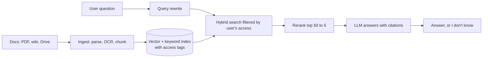
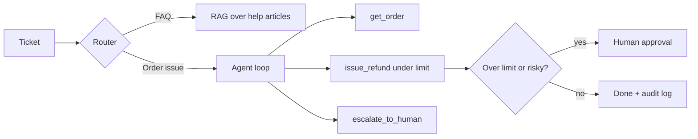
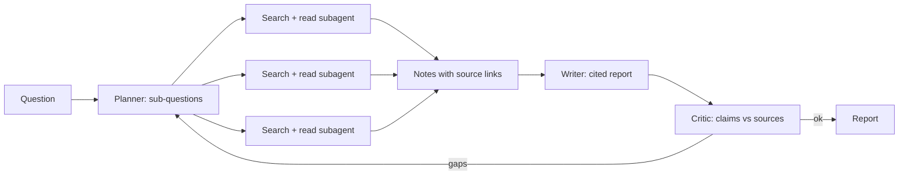
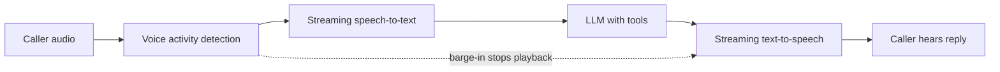
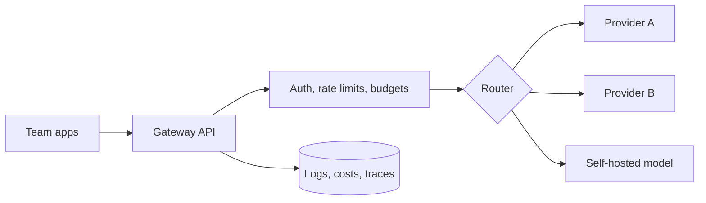
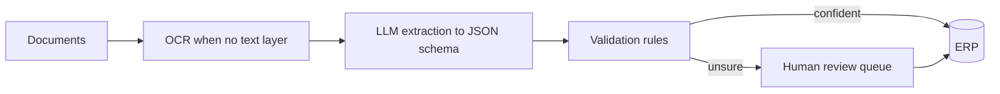

# AI system design for FDE interviews

Six designs that come up in FDE interviews and in real client work. For each: the questions to ask first, an architecture, the decisions that matter, how it fails, and what to measure. In the interview, spend the first minutes on the questions.

## How to answer any AI system design question

1. **Clarify** the user, the success metric, data, scale, latency and cost limits.
2. **Start simple:** the smallest design that could work, end to end.
3. **Show where it fails** and fix the biggest risk first.
4. **Say how you'll measure it:** the eval set and the production metrics.
5. **Cover safety and operations:** permissions, PII, tracing, fallbacks, cost.

## 1. Chat with company documents (RAG)

An assistant that answers employees' questions from 50,000 internal PDFs and wiki pages, with citations, respecting who can see what.

**Ask first**

- How many documents, how often they change, which formats (scans?)
- Who may see which documents; is access per team or per document?
- What does a correct answer look like, and who decides?
- Latency and cost budget per question

**Key decisions**

- Chunking by document structure (headings), with overlap only if evals show it helps
- Access control applied at retrieval time, not after generation
- Hybrid search because employees search for exact names, codes and IDs
- Re-index incrementally on change; store the embedding model version with every vector

**How it fails**

- Answer is in a table or scanned page that never got text
- Stale document wins over the current one
- User sees a passage from a document they can't access

**Measure:** recall@k on a golden set, answer faithfulness, citation accuracy, p95 latency, cost per question

## 2. Customer-support agent that takes actions

An agent that resolves order and refund tickets: looks up orders, issues refunds under a limit, and hands off to a human otherwise.

**Ask first**

- Which actions are allowed, and the money limit for each
- Which systems hold orders, payments and tickets (systems of record)
- What must always go to a human
- Languages and channels

**Key decisions**

- Narrow tools with typed arguments; the refund tool enforces the limit itself, not the prompt
- A step limit and a timeout on the loop
- Human approval for anything irreversible or above a threshold
- Every action written to an audit log

**How it fails**

- Prompt injection in the customer's message
- The agent loops between two tools
- Refund issued twice on a retry

**Measure:** resolution rate without a human, wrong-action rate, escalation rate, time to resolution, cost per ticket

## 3. Deep research agent

Given a question, the agent plans searches, reads sources, and writes a cited report in under five minutes.

**Ask first**

- How fresh must sources be; which sources are trusted
- Report length and format
- Budget per report

**Key decisions**

- Subagents run in parallel with their own small context
- Every claim keeps its source link through to the report
- A token and time budget that stops the loop

**How it fails**

- Citing a source that doesn't support the claim
- Runaway cost from unbounded searching

**Measure:** claim-level citation accuracy, coverage of a reference answer, time and cost per report

## 4. Real-time voice agent

A phone assistant for appointment booking that listens, replies within about a second, and can be interrupted.

**Ask first**

- Languages and accents
- Which actions it can take (book, cancel, reschedule)
- Latency target for the first audio reply

**Key decisions**

- Stream every stage; start speaking before the full reply is generated
- Short, spoken-style responses
- Barge-in: stop talking the moment the caller speaks
- Confirm details back before booking

**How it fails**

- Long silences while a tool runs
- Mishearing names and numbers

**Measure:** time to first audio, task completion rate, interruption handling, transcription error rate on names and numbers

## 5. LLM gateway for a company

One internal service every team uses to call models: routing, keys, budgets, logging and fallbacks.

**Ask first**

- Which providers and models are approved
- Data rules per team
- Budget ownership

**Key decisions**

- One API shape for all models
- Per-team keys, budgets and alerts
- Automatic fallback when a provider errors or is slow
- PII redaction before logging

**How it fails**

- One team's spike starves everyone else
- Logs quietly storing sensitive data

**Measure:** availability, p95 latency overhead, cost per team, fallback success rate

## 6. Document extraction pipeline

Pull 30 fields out of thousands of invoices and contracts a day into the client's ERP.

**Ask first**

- Document types and quality (scans, handwriting)
- Which fields matter most and the cost of an error
- Who reviews uncertain cases

**Key decisions**

- Structured output against a strict schema
- Rule checks (totals add up, dates valid) before writing anywhere
- Confidence routing to a review queue

**How it fails**

- Silent wrong values that pass validation
- Throughput collapse on a batch of scans

**Measure:** field-level accuracy, share sent to review, documents per hour, cost per document

---

Mock system-design rounds with feedback are in Week 12 of [Zero to FDE](https://zero-to-fde-90-days.site/forward-deployed-engineer-program?utm_source=github&utm_medium=referral&utm_campaign=roadmap_repo&utm_content=system-design).
